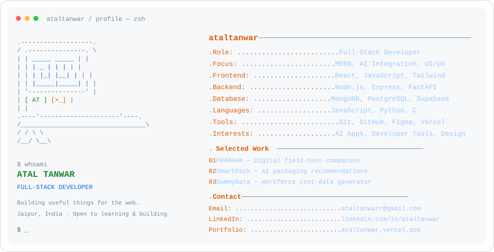

<a href="https://ataltanwar.vercel.app/">
  <picture>
    <source media="(prefers-color-scheme: dark)" srcset="https://raw.githubusercontent.com/ataltanwar/ataltanwar/main/dark_mode.svg">
    
  </picture>
</a>

  <a href="https://ataltanwar.vercel.app/"><picture><source media="(prefers-color-scheme: dark)" srcset="https://raw.githubusercontent.com/ataltanwar/ataltanwar/main/link_portfolio_dark.svg"></picture></a><a href="https://www.linkedin.com/in/ataltanwar/"><picture><source media="(prefers-color-scheme: dark)" srcset="https://raw.githubusercontent.com/ataltanwar/ataltanwar/main/link_linkedin_dark.svg"></picture></a><a href="mailto:ataltanwarr@gmail.com"><picture><source media="(prefers-color-scheme: dark)" srcset="https://raw.githubusercontent.com/ataltanwar/ataltanwar/main/link_email_dark.svg"></picture></a>

<picture>
  <source media="(prefers-color-scheme: dark)" srcset="https://raw.githubusercontent.com/ataltanwar/ataltanwar/output/pacman-contribution-graph-dark.svg">
  <source media="(prefers-color-scheme: light)" srcset="https://raw.githubusercontent.com/ataltanwar/ataltanwar/output/pacman-contribution-graph.svg">
  
</picture>

Built with curiosity, coffee, and a lot of commits.

